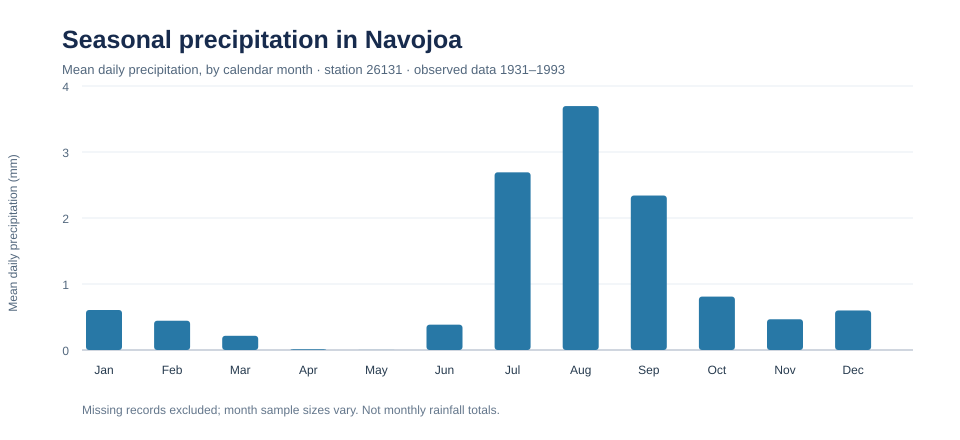
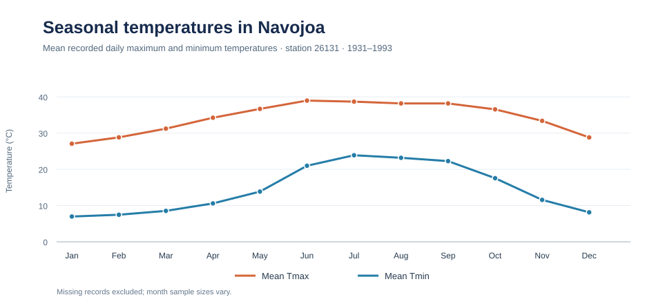

# Historical Climate Analysis | Navojoa, Mexico 🌦️

**Exploratory Data Analysis · Data Cleaning · Time Series Visualization**

A Python-based exploration of historical daily weather observations from **Navojoa (FFCC) station 26131**, Sonora, Mexico. The project studies the seasonal distribution of precipitation and maximum/minimum temperatures, and illustrates how rolling averages reveal patterns at different time scales.

[**Explore the author's EDA (annotated)**](BD_Climatologica_Navojoa.ipynb) · [**Explore the author's time-series analysis (annotated)**](Climatologia_Navojoa_Series_Tiempo.ipynb) · [**Return to my portfolio**](https://github.com/ClaudethClarissa/data-science-portfolio)

---

## Project at a glance

| | |
|---|---|
| **Location** | Navojoa, Sonora, Mexico |
| **Station** | Navojoa (FFCC), ID 26131 |
| **Coordinates** | 27.081° N, 109.445° W |
| **Elevation** | 41 m above sea level |
| **Available daily record** | January 1931 – July 1993 (with missing observations and unequal coverage) |
| **Variables analyzed** | Daily precipitation (mm), maximum and minimum air temperature (°C) |
| **Tools** | Python, pandas, NumPy, Matplotlib, Seaborn, statsmodels, Jupyter Notebook |

## Questions explored

- How are precipitation and temperature distributed across the calendar year?
- How do observed temperatures and precipitation vary across years?
- What becomes visible when daily temperatures are smoothed with moving averages at different time scales?
- What limitations must be considered when interpreting an incomplete historical record?

## Data source

The daily observations in [`ClimatologiaNavojoa.txt`](ClimatologiaNavojoa.txt) are labeled **CNA–SMN** (Mexico's National Meteorological Service), with a file issue date of April 6, 2020. The file identifies station 26131 as **Navojoa (FFCC)** and notes the station's status as suspended.

Two additional reference files are provided:
- [`ExtremosNavojoa.TXT`](ExtremosNavojoa.TXT): monthly historical extremes and related statistics.
- [`NORMAL26131.TXT`](NORMAL26131.TXT): published climatological normals, labeled **1951–2010**. These reference values should not be treated as estimates from the entire 1931–1993 daily record.

The original file includes an evaporation column, but the analysis omits it because the supplied daily observations do not contain usable evaporation values.

## Annotated notebooks — faithful to the original analysis

These are the **recommended starting points** for readers. They retain the original code's analysis sequence, plots and results, with beginner-friendly English explanations and limited compatibility updates:

- [01 — Original EDA, annotated](BD_Climatologica_Navojoa.ipynb): monthly and annual summaries, temperature histograms, density estimates (KDE), boxplots and precipitation/temperature figures.
- [02 — Original time-series analysis, annotated](Climatologia_Navojoa_Series_Tiempo.ipynb): daily records, selected historical periods, and 7-, 30- and 365-observation rolling averages.

The fully preserved historical notebooks and their Python exports are in [`archive/originals/`](archive/originals/). The featured notebooks above retain the author's analysis and are placed at the repository root for easy discovery.

## Additional reproducible notebooks

- [01 — Data Cleaning & EDA](archive/compact-notebooks/01_data_cleaning_eda.ipynb): data quality, monthly means, distributions, and temperature visualization.
- [02 — Time Series Analysis](archive/compact-notebooks/02_time_series_analysis.ipynb): daily calendar reindexing, time-series plots, rolling windows, and year-by-year coverage.
- [03 — Reproducible Monthly Summary](archive/compact-notebooks/03_reproducible_monthly_summary.ipynb): the shared code behind the README figures.

The untouched original versions are stored in `archive/originals/`. The compact companion notebooks use shared functions in [`scripts/climate_processing.py`](scripts/climate_processing.py). They require `pandas`, `numpy`, `matplotlib`, `seaborn`, and Jupyter.

## Analysis workflow

### 1. Data preparation & exploratory analysis

[`BD_Climatologica_Navojoa.ipynb`](BD_Climatologica_Navojoa.ipynb)

- Load the station's text-formatted daily observations.
- Replace the source's `Nulo` entries with missing values.
- Convert temperature and precipitation to numeric data and parse dates.
- Derive calendar month and year.
- Examine descriptive statistics, distributions, monthly/annual summaries, histograms, density plots, and box plots.

### 2. Time series exploration

[`Climatologia_Navojoa_Series_Tiempo.ipynb`](Climatologia_Navojoa_Series_Tiempo.ipynb)

- Index observations by date and inspect time coverage.
- Visualize daily precipitation and minimum/maximum temperatures.
- Zoom into selected historical periods.
- Compare observed temperatures with centered rolling means using windows of **7, 30, and 365 observations**.

> **Interpretation note:** The **original** time-series notebook uses row-based rolling windows; the **modernized** notebook reindexes to the daily calendar and applies calendar-day windows. Neither approach establishes a climate trend or produces a forecast.

## Verified visualizations

These figures are calculated directly from the supplied daily station records, grouping **nonmissing daily observations by calendar month**. Unequal coverage across years and months should be considered when interpreting the averages.

### Precipitation by month



The highest observed mean daily precipitation occurs in **August (3.70 mm/day)**, followed by **July (2.69 mm/day)** and **September (2.34 mm/day)**. These are *average recorded daily precipitation values*, **not** monthly rainfall totals.

### Temperature by month



The highest monthly mean of recorded daily maximum temperatures is in **June (38.97 °C)**. The mean recorded daily minimum temperature peaks in **July (23.89 °C)**.

To regenerate the numeric summary and the two SVG charts from the original dataset using only Python's standard library, run:

```bash
python scripts/generate_figures.py
```

The script writes `reports/monthly_summary.csv` and both SVG charts. A [companion notebook](archive/compact-notebooks/03_reproducible_monthly_summary.ipynb) runs the same calculations.

## Descriptive observations

The following are observations from the *supplied reference tables*, not newly calculated results from the notebooks:

- The 1951–2010 **climatological normals file** lists **August** as the wettest month on average (**121.6 mm**) and **May** as the driest (**0.0 mm** in its reported rounded normal).
- That same reference lists an annual normal precipitation of **407.2 mm**.
- The monthly normal maximum temperature peaks in **June (37.2 °C)**, while the monthly normal minimum temperature peaks in **July (23.0 °C)**.

These figures provide climatological context. A comparable summary directly derived from the daily dataset would require documenting coverage and missing-data rules.

## Repository contents

```text
Meteorological-Data-Analysis/
├── BD_Climatologica_Navojoa.ipynb           # Featured EDA (annotated, with figures)
├── Climatologia_Navojoa_Series_Tiempo.ipynb # Featured time-series analysis
├── ClimatologiaNavojoa.txt                  # Daily source observations
├── ExtremosNavojoa.TXT
├── NORMAL26131.TXT
├── README.md
├── archive/
│   ├── originals/                           # Unchanged original notebooks and .py exports
│   └── compact-notebooks/                   # Optional shorter companion analyses
├── scripts/                                 # Reusable analysis and figure-generation code
├── reports/figures/                         # Reproducible summary graphics
├── tests/                                   # Regression tests
└── .github/workflows/validate.yml
```

## Reproduce the analysis

1. Clone the repository:
   ```bash
   git clone https://github.com/ClaudethClarissa/Meteorological-Data-Analysis.git
   cd Meteorological-Data-Analysis
   ```
2. Set up your Python environment (Python 3.11 is used by CI), then install the notebook dependencies:
   ```bash
   python -m pip install notebook numpy pandas matplotlib seaborn statsmodels nbconvert ipykernel
   ```
3. Regenerate the README figures and monthly summary:
   ```bash
   python scripts/generate_figures.py
   ```
4. Open the **two featured notebooks at the repository root**:
   ```bash
   jupyter notebook
   ```
5. Run automated regression tests:
   ```bash
   python -m unittest discover -s tests -v
   ```

GitHub Actions executes the two featured author-preserving notebooks and regression tests for proposed changes. Archived compact notebooks are supplemental examples. Original notebooks and scripts are preserved as historical versions and may need older dependencies to execute without modification.

## Limitations & planned improvements

- **Incomplete historical coverage:** Missing daily values and differing year/month coverage can bias naive comparisons; validate completeness before making year-to-year or trend claims.
- **Precipitation aggregation:** Daily precipitation averages and monthly/annual precipitation **totals** are different quantities. Some existing plot labels should be revised to match the actual calculation.
- **Rolling-window definitions:** The modernized notebook uses calendar-day windows; the historical notebook used row-count windows. Explicitly state the approach when comparing plots.
- **Data-cleaning robustness:** The modernized pipeline discards non-date footer rows by parsing dates; further audit of date completeness and abnormal observations would improve reliability.
- **Reproducibility:** The modernized notebooks and plot generation are CI-tested. Dependency versions are not yet pinned for long-term preservation.
- **Next analysis:** Compare seasonal patterns across well-observed periods and explicitly quantify completeness before evaluating any long-term trend.

This repository documents an exploratory scientific analysis, **not** a validated climate-change attribution study or operational weather forecast.

---

**Portfolio:** [Data Science & Analytics Portfolio](https://github.com/ClaudethClarissa/data-science-portfolio) · **Author:** [Claudeth Hernandez](https://github.com/ClaudethClarissa)
